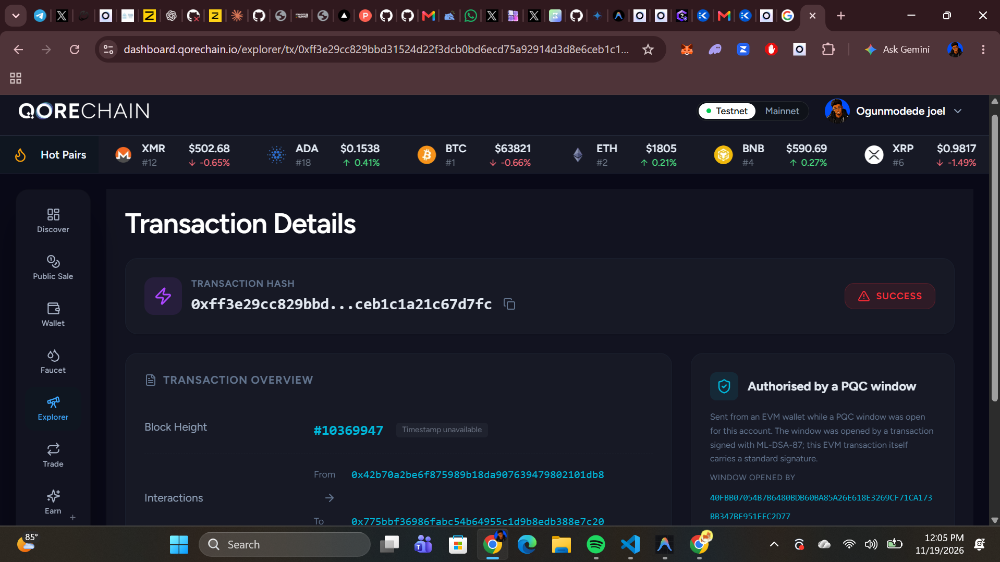
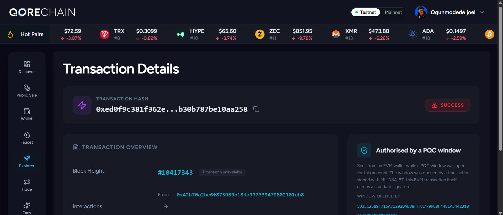

# On-chain evidence (QoreChain testnet, chain id 9800, qorechain-diana)

| Name | Value |
| --- | --- |
| Rewind contract | `0x775BbF36986FaBC54b64955c1D9b8EdB388E7c20` |
| Deployer, buyer and window account | `0x42B70a2Be6F875989b18DA907639479802101DB8` (`qor1g2ms52lxlp6e3xccm2g8vw28nqppq8dc5e02fn`) |
| PQC key registration transaction | `704DE2D6814F8D8109461D385C8C73A29DBD21664291E1353C698A369806A789` |
| EVM window opened for agreement 2 | `40FBB07054B7B6480BDB60BA85A26E618E3269CF71CA173BB347BE951EFC2D77` |
| createAgreement (agreement 2, gas used 144327) | `0xac357fc1a476a424013126711ce8177a89394fccdc9a9849e1dca5c8163f677c` |
| refund with ML-DSA-87 authorisation (agreement 2, gas used 220420) | `0xff3e29cc829bbd31524d22f3dcb0bd6ecd75a92914d3d8e6ceb1c1a21c67d7fc` |
| Scoped window (allowedTargets = Rewind contract only) | Opening tx `E06768BE9E60F3969ABEBE74C92FEBAA9E3A070D18BE2214457B160B68BDC48C` |
| Second scoped window, opened before sign and release of agreement 3 | `5D35C25B9F716A71292DAB88FF7A7799C0F4481AE44231831AB8F6E2CDBB9035` |
| Seller account | `0xd0e5B9fc404b1036a7C53128B6B756b23e0EFcf0` (`qor16rjmnlzqfvgrdf79xy5tdd6kkglqal8s3rmk62`), PQC key registered, own scoped window |
| createAgreement (agreement 3, gas used 144315) | `0x401cfe0a0a7244cef86479e4fc0301b7555f3113b8d4b8c8d519bbb718e08f79` |
| markFulfilled by the seller (agreement 3, gas used 42280) | `0xd9b31a36ee00674593e3b5fbf1c0f6577cb0970d0d718115511247c082326ba7` |
| release with ML-DSA-87 authorisation (agreement 3, gas used 222894) | `0xed0f9c381f362e5799778b2d7eee91079b6143bedd4257e0b30b787be10aa258` |

## Screenshots

*Refund transaction explorer screenshot.*

*Refund transaction explorer screenshot, lower section.*

*Release transaction explorer screenshot.*

Missing screenshot file: `attack-forged-refund.png`.

## Terminal output

- [Forged refund simulation](terminal-output.md#forged-refund-attack-demo-refund-forged-1)
- [Out-of-scope transfer attempt](terminal-output.md#out-of-scope-transfer-attempt-attack-demo-transfer-out---send)
- [Scoped window status](terminal-output.md#scoped-window-status-shortly-after-opening)

## What this shows

- The refund was authorised by a post-quantum ML-DSA-87 signature verified by the chain's `pqcVerify` precompile inside the contract.
- The EVM transaction itself carries a standard signature and was sent while a PQC window was open.
- The explorer labels it "Authorised by a PQC window".
- The agreement state is `Refunded`.

## Honest notes

- The forged-refund attack is an `eth_call` simulation against the live chain. No transaction was sent.
- The chain refused the out-of-scope transfer with a window refusal labelled "exhausted". That refusal alone does not prove that the scope caused it. A call to the Rewind contract succeeded in the same live window.
- The REST read-back of the window omits `validators`, `stakingValidators` and `ibcReceivers`, so those scopes are not confirmed.
- The release command generates its own signature at send time. The web UI's paste-the-signature flow has not been tested end to end on chain.
