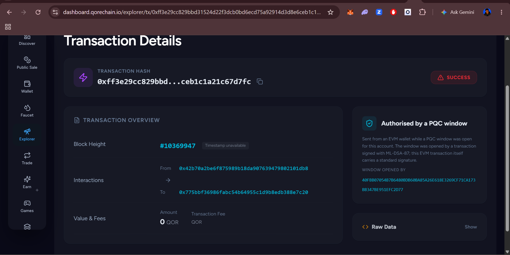

# On-chain evidence (QoreChain testnet, chain id 9800, qorechain-diana)

| Name | Value |
| --- | --- |
| Rewind contract | `0x775BbF36986FaBC54b64955c1D9b8EdB388E7c20` |
| Deployer, buyer and window account | `0x42B70a2Be6F875989b18DA907639479802101DB8` (`qor1g2ms52lxlp6e3xccm2g8vw28nqppq8dc5e02fn`) |
| PQC key registration transaction | `704DE2D6814F8D8109461D385C8C73A29DBD21664291E1353C698A369806A789` |
| EVM window opened for agreement 2 | `40FBB07054B7B6480BDB60BA85A26E618E3269CF71CA173BB347BE951EFC2D77` |
| createAgreement (agreement 2, gas used 144327) | `0xac357fc1a476a424013126711ce8177a89394fccdc9a9849e1dca5c8163f677c` |
| refund with ML-DSA-87 authorisation (agreement 2, gas used 220420) | `0xff3e29cc829bbd31524d22f3dcb0bd6ecd75a92914d3d8e6ceb1c1a21c67d7fc` |

## Screenshots

*Refund transaction explorer screenshot.*

*Refund transaction explorer screenshot, lower section.*

## What this shows

- The refund was authorised by a post-quantum ML-DSA-87 signature verified by the chain's `pqcVerify` precompile inside the contract.
- The EVM transaction itself carries a standard signature and was sent while a PQC window was open.
- The explorer labels it "Authorised by a PQC window".
- The agreement state is `Refunded`.
